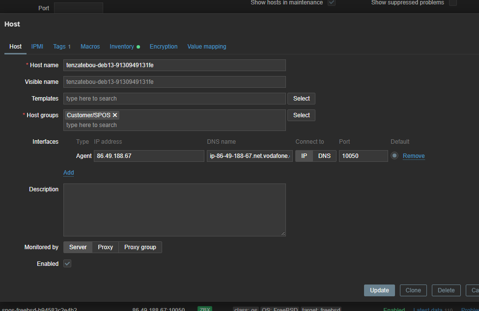
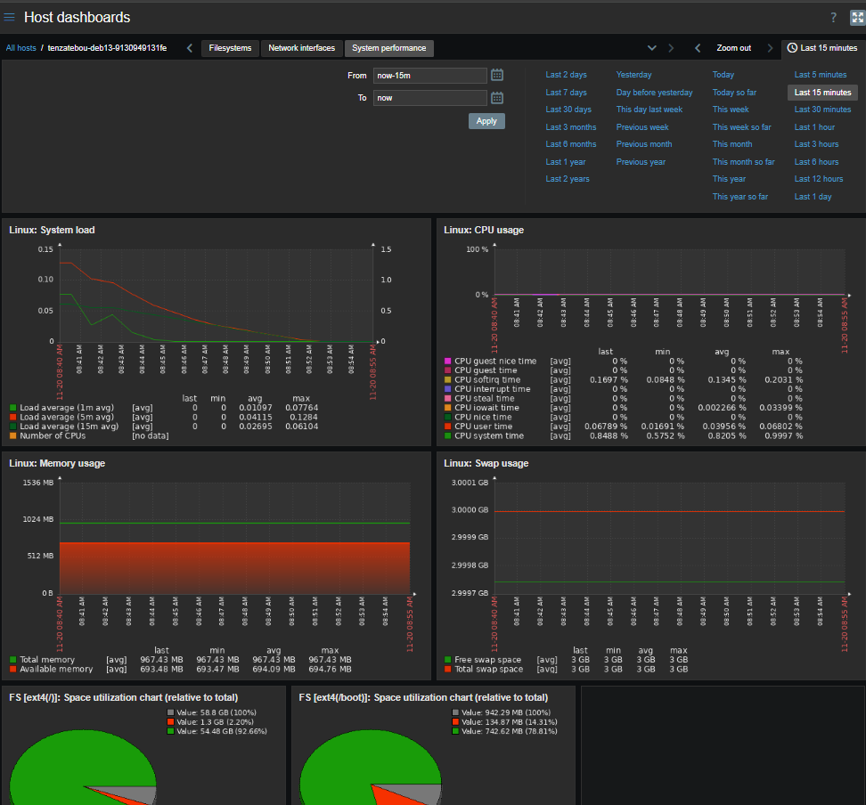

# Automatická registrace Debianu 13 do Zabbixu 8.0


*Úvodní ilustrační obrázek k projektu (Debian 13 + Zabbix 8.0).*

Cílem úlohy do OSY bylo rozjet pomocí Vagrantu virtuální stroj s **Debianem 13** a kompletně zautomatizovat instalaci a nastavení **Zabbix Agent 2 (8.0 LTS)** tak, aby se stroj sám zaregistroval na školní server `enceladus.pfsense.cz`.

## Jak je to poskládané

Celý provisioning je rozdělený do tří samostatných skriptů, které spouští `Vagrantfile`:

- **`Vagrantfile`** – spustí box `bento/debian-13` (1024 MB RAM, 1 CPU, přesměrování SSH na port `2210`) a postupně zavolá všechny tři skripty.
- **`install-tools.sh`** – doinstaluje základní nástroje pro práci a diagnostiku v terminálu (`wget`, `curl`, `vim`, `htop`, `mc`, `nmap`, `netcat-openbsd`, `git`).
- **`install-zabbix8-agent.sh`** – přidá oficiální repozitář Zabbix 8.0 pro Debian 13, nainstaluje `zabbix-agent2` a ověří, že jde opravdu o verzi 8.x. Pokud už je agent nainstalovaný, při dalším spuštění krok přeskočí.
- **`configure-zabbix8-agent.sh`** – vygeneruje jedinečný název hosta ve tvaru `tenzatebou-deb13-xxxxxxxxxxxx` a uloží ho do `/var/lib/zabbix/spos-hostname`, aby zůstal stejný i po restartu nebo opakovaném `vagrant provision`. Potom zazálohuje původní config (`.orig`), smaže staré řádky kvůli duplicitám, zapíše `Server`, `ServerActive` (`enceladus.pfsense.cz`), `Hostname` a `HostMetadata=SPOS` a nastartuje službu.

## Spuštění a kontrola

Kontrola syntaxe a spuštění virtuálky:

```bash
vagrant validate
vagrant up
```

Ověření, že opakovaný provisioning nepřepíše název hosta ani nenadělá duplicity v konfiguraci:

```bash
vagrant provision
```

Rychlá kontrola uvnitř stroje po připojení přes `vagrant ssh`:

```bash
cat /var/lib/zabbix/spos-hostname
zabbix_agent2 -V | head -n 1
sudo systemctl status zabbix-agent2 --no-pager
grep -E '^(Hostname|Server|ServerActive|HostMetadata)=' /etc/zabbix/zabbix_agent2.conf
nc -z -w 5 enceladus.pfsense.cz 10051
```

## Výsledek v Zabbixu

Po spuštění se virtuálka přes aktivního agenta sama přihlásila na `enceladus.pfsense.cz` a díky `HostMetadata=SPOS` dostala automaticky přiřazenou skupinu, štítek i šablonu pro Linux.



*Automaticky zaregistrovaný host v rozhraní Zabbixu včetně přiřazené skupiny a šablony pro Linux.*



*Ukázka aktuálně sbíraných dat a metrik z běžícího Debianu 13.*